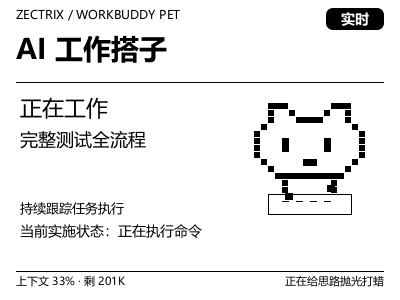

# WorkBuddy 宠物（ZECTRIX Note 4）

让像素宠物显示真实的 WorkBuddy 任务状态。作为独立本机程序运行于 Windows，当前支持 Note 4。
设备固件必须与本地推送 SDK 配套；`zectrix-sdk` 0.1.0 对应固件 3.7.2。Note 4C 不在兼容范围内。



*实机画面，原尺寸 400×300。一次真实推送：任务进行中、宠物在工作，底部是上下文占用与花絮。
重新生成：`workbuddy-pet preview --out docs/preview.png`。*

## 与 SDK 的边界

本仓库可单独克隆、编译、测试。它以路径依赖引用官方 [zectrix-local-push-sdk](https://github.com/itopinion/zectrix-local-push-sdk)
（`../zectrix-local-push-sdk`），**不复制、不修改、不携带** SDK 与固件。

- 宠物仓库负责：任务状态、WorkBuddy 跟随、权限提醒、400×300 像素画面、按键、提示音、
  连接时机与占用策略。
- SDK 负责：局域网协议、灰度量化（mono / gray4 / gray16）、音频播放、设备事件。
- 固件由你自己按官方指引升级。本程序不检查、不升级固件，也不自动连接未指定的设备。

`src/device.rs` 是 SDK 的薄封装（打开、推图、播放、读事件、关闭），不实现协议。

## 兼容性

| 项目 | 要求 |
| --- | --- |
| 设备 | ZECTRIX Note 4（`zectrix-s3-epaper-4.2`），画布 400×300 |
| 固件 | 3.7.2（`zectrix-sdk` 0.1.0 配套）。**不支持 Note 4C**，其他固件不承诺 |
| 系统 | Windows 10/11 x64（实测 Windows 11 专业版 / i5-12500H / rustc 1.99.1 / CMake 4.4.4） |
| 网络 | 设备与电脑在同一局域网；设备上开启「设置 → 网络同步 → 待机保持 Wi-Fi」 |
| API Key | 本地直连**不需要**极趣云 API Key；本程序不读取任何账号或密钥 |

## 安装

1. **准备工具链**：Rust（MSVC 工具链）、CMake、Visual Studio C++ Build Tools（SDK 的原生 Opus 需要）。
2. **取官方 SDK**（放到与本项目同级的目录）：

   ```bat
   cd D:\repositories
   git clone https://github.com/itopinion/zectrix-local-push-sdk.git
   ```

3. **构建**：

   ```bat
   cd D:\repositories\workbuddy-pet
   set CMAKE_POLICY_VERSION_MINIMUM=3.5
   cargo test --locked --release
   cargo build --locked --release
   ```

   `CMAKE_POLICY_VERSION_MINIMUM=3.5` 不能省：CMake 4.x 对 SDK 内置的旧版 Opus 脚本会报
   「Compatibility with CMake < 3.5 has been removed」。这是 SDK README 给的处理办法。
   产物是 `target\release\workbuddy-pet.exe`。

4. **首次初始化**：`workbuddy-pet init` 会依次检查现状（数据目录、WorkBuddy 会话、已存地址、
   跟随与声音设置）→ 自动发现并连接设备（打印型号、电量、信号）→ 渲染预览到
   `%LOCALAPPDATA%\zectrix-workbuddy-pet\out\pet-init.png` → **你确认后**才推第一张画面 →
   询问是否开机自启。在此之前设备不会被动到。
5. **日常使用**：

   ```bat
   workbuddy-pet autostart on --target 192.168.1.100
   ```

   之后登录 Windows 就在后台待命，有任务才占用设备。升级保留现有设置与任务记录。

接入时核对到的基线：参照项目 [zectrix-agent-pet](https://github.com/itopinion/zectrix-agent-pet)
（核查日期 2026-10-20，参考提交 `2c9213d`）、[SDK API 文档](https://github.com/itopinion/zectrix-local-push-sdk/blob/main/docs/API.md)、
[兼容性清单](https://github.com/itopinion/zectrix-local-push-sdk/blob/main/compatibility.json)。
**执行前请重新核对当前版本**，接口以当前源码为准。

完整命令、按键与提示音细节见 [USAGE.md](USAGE.md)。

## 状态与操作

- 待命：WorkBuddy 已启动但还没有任务；守护只读会话文件，**不占用设备**。
- 正在工作：用户刚发起一轮任务；无清单时显示「当前实施状态：正在修改文件 / 正在执行命令」。
- 等你处理：结构化提问，或主进程上报的确认事件；回到对应 WorkBuddy 窗口处理。
- 任务完成、遇到问题、已停止：来自明确的生命周期记录。
- 状态待确认：超过 15 分钟无更新。只表示需要确认，不会自动判成功。

设备左侧是任务名（与 WorkBuddy 侧边栏同源；过长自动换行，超过三行以「…」省略）。同一会话只显示最新一轮。
最多列出 4 个任务，超过时上下键翻页（末页循环回首页）；4 个以内上下键选择任务；
确认键恢复首页与自动跟随，**不会**批准 Agent 的任何操作。列表顺序按会话标识固定，
心跳和状态更新不会换位。

有清单时显示「任务清单 3/7 · 43%」；Agent 主动上报过进度则显示「上报 65%」，两者措辞严格区分，
未知进度不生成百分比。左下角是当前会话的上下文占用（读 `session_usage.used/size`，每 15 秒查一次，
整百分比变化才刷屏），右下角是花絮短语——直接镜像 WorkBuddy 界面此刻显示的那条
（推送时采一次，任务进行中每 30 秒再采一次，真变了才重推；读不到时回退内置短语池）。

等待确认时播放两短哔，任务完成时播放上行三连音；默认音量 90%，`--volume` 可调，`--no-sound`
可关。重复状态、启动时的历史回放不会响铃；同一条提醒只响一次（指纹存在 `state.json` 的
`announced`），设备反复重连也不会重复吵人。播放失败不重试。

### 设备占用

一台设备同一时刻只允许一个连接，所以守护按任务开关设备：

| 阶段 | 行为 | 设备 |
| --- | --- | --- |
| WorkBuddy 未启动 | 每 5 秒看一眼进程 | 空闲 |
| 待命（无任务） | 只读会话文件，不连接 | 空闲 |
| 有任务（工作 / 等你处理） | 连接、推送、翻页、响铃 | 被占用 |
| 任务结束 | 再守 5 分钟 | 期内没新任务就 `close()` 交还 |

`--idle-grace 120` 可改宽限（秒），`0` 表示任务一结束就交还，值存进 `state.json`。
「等你处理」也算活跃任务，但超过 15 分钟没有新动静会判为「状态待确认」并交还设备——
一张被遗忘的确认卡不该把设备锁死。设备休眠导致的 `Timeout` 断开只在任务仍活跃时按
15 秒步长退避重连，连续失败 5 次就停下等下一个任务，不与别的程序抢设备。

## 本机 WorkBuddy 跟随

守护启动即跟随本机会话，无需额外开关。它只读三处本机数据，全部只取元数据：

- `~/.workbuddy/projects/<项目>/<会话>.jsonl`：轮次开始、结构化提问 / 退出计划、
  助手消息状态、`todo_write` 清单条目数与完成数。
- `~/.workbuddy/logs/main.log`：`[TaskNotify] pending: session=<id> kind=question|permission`。
  **权限确认卡不写会话 JSONL**，这是唯一能覆盖所有确认形态（含写入卡、命令确认、其他会话）的信号源。
- `~/.workbuddy/workbuddy.db`：`sessions` 表取侧边栏显示的会话名（`custom_title` 优先），
  `session_usage` 表取上下文占用。

任务名与侧边栏一致：侧边栏改名**只写数据库、不写会话文件**，所以程序读库，改名后 15 秒内跟上；
读不到库时才退到 JSONL 里的 `ai-title`，再退到本轮提问首行。名称会显示在设备上，
勿在会话名中放置秘密。

这是对本地文件与库表格式的适配，并非 WorkBuddy 的稳定状态 API。格式变化、文件被清理或
超出扫描范围时可能无法跟随；`main.log` 轮转到扫描窗口之外时，写入确认会退回「写入工具卡住
10 秒」的启发式，可能误报一次。普通文本提问、失败的工具调用、未知工具都不会被猜成等待或失败。

## 数据

数据在本机 `%LOCALAPPDATA%\zectrix-workbuddy-pet\`：

- `state.json`：设置、最近 100 条任务、设备地址、已提醒指纹。升级保留，不覆盖。
- `out\`：`preview` / `init` 渲染的 PNG。
- `watch.log`：守护输出。不含对话内容、账号或密钥。

从早期 `pet4` 目录升级时会复制一份旧 `state.json`（只复制，不删源）。`state.json` 含设备地址，
不要分享或上传；卸载时用 `workbuddy-pet forget` 删除。

## 开发

```bat
cargo fmt
set CMAKE_POLICY_VERSION_MINIMUM=3.5
cargo clippy --locked --release --all-targets
cargo test --locked --release
cargo build --locked --release
```

46 项测试（状态机、标题解析、去抖、占用判定、版式、提示音）。模块分工：
`model`（状态机与任务表）、`workbuddy`（本机数据源与信号源）、`layout` + `raster`（场景与灰度 PNG）、
`sound`（PCM16 合成）、`device`（SDK 封装）、`main`（命令、占用策略、推送循环）。

不连设备也能出图：`workbuddy-pet preview`（`--demo working|waiting|done|error` 看各状态版式，
演示状态只在内存，不写任务历史，也不代表真实进度）。仅 Windows x64 验证；macOS / Linux 未验证。

## 已知边界

- **积分余额读不到**：那是云端数据，本地无缓存，左下角改显示可精确读取的上下文占用。
- **不能替你在电脑上点选项**：选项卡片只接受鼠标；模拟键盘能送达窗口但卡片无响应。
  等待画面只提示「请回电脑确认」。
- **积分 / 计费类信息不显示**，只读上述三处本机数据。
- **单连接**：切换程序前先退出旧的，否则会拿到 `Busy`；强杀后固件约 15 秒才释放租约。
- **`ResultUnknown` 不重试**：SDK 无法确认结果时不重新刷图、不重播，避免重复动作。
- **提示音是设备提示音**：16 kHz 单声道 PCM16；SDK 不含语音识别、TTS 或大模型。
- **交互应用需要电脑上的程序持续运行**；推图成功不等于应用安装到了设备。

## 排错

| 现象 | 处理 |
| --- | --- |
| 构建报 CMake < 3.5 兼容错误 | 设 `CMAKE_POLICY_VERSION_MINIMUM=3.5` 后重试 |
| `--locked` 报锁文件不一致 | 只在确实改过依赖时去掉 `--locked` 更新 `Cargo.lock` |
| 连不上 / 超时 | 确认同局域网、IP 正确、设备已开「待机保持 Wi-Fi」、没有别的程序占用 |
| 刚强杀过进程 | 等 15 秒让固件释放租约 |
| 中文显示为方块 | 确认 `C:\Windows\Fonts\msyh.ttc`、`msyhbd.ttc` 存在 |
| 设备停在旧画面 | 系统通知会临时覆盖约 12 秒；`push` 打印「已推送」即设备报告显示完成 |

## 许可

MIT。模型 / 布局 / 音效逻辑复用自 [zectrix-agent-pet](https://github.com/itopinion/zectrix-agent-pet)
0.3.4（MIT），设备通道使用 [zectrix-local-push-sdk](https://github.com/itopinion/zectrix-local-push-sdk) 0.1.0。
