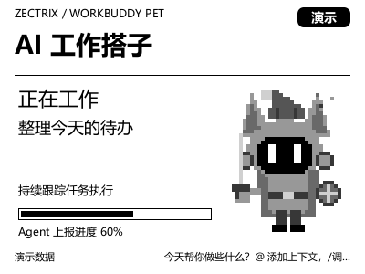
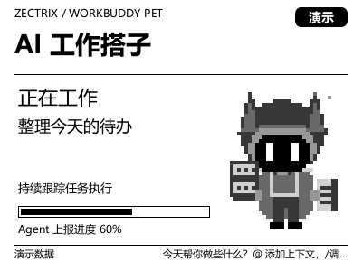
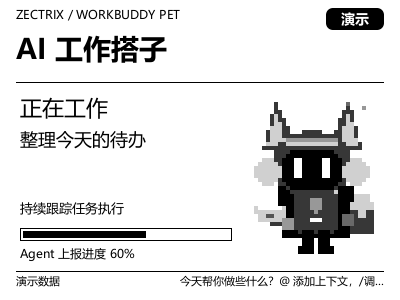
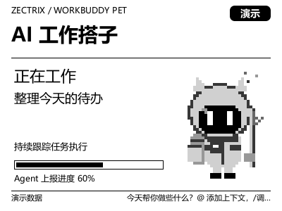

# WorkBuddy 宠物（ZECTRIX Note 4）

把 WorkBuddy 的实时任务状态显示在 ZECTRIX Note 4 墨水屏上（400×300）。Windows 本机程序：只读本机会话文件、
局域网直连设备，不上传数据、不写系统目录。

<table>
  <tr>
    <td align="center"><br><b>像素喵</b> <code>pixel</code>（默认）<br>针织尖帽 · 光剑与圆盾</td>
    <td align="center"><br><b>金算喵</b> <code>abacus</code><br>连帽衫 · 算盘与账本</td>
  </tr>
  <tr>
    <td align="center"><br><b>暴富喵</b> <code>fortune</code><br>机能外套 · 大耳机 · 金条</td>
    <td align="center"><br><b>星际喵</b> <code>astro</code><br>宇航服 · 头盔 · 猫爪旗</td>
  </tr>
</table>

*四套造型共用同一套骨架与六种状态表情，只换帽子、服装与道具。图中为 `preview --demo working` 的演示数据，
原尺寸 400×300。切换见「命令速查」——也可以直接在设备上长按上/下键。*

## ⚠️ 需要人工操作的注意事项

这几件事 AI 代不了，**部署前先确认**，否则表现为「装好了但设备没画面」。

1. **在设备上打开「待机保持 Wi-Fi」**：设置 → 网络同步 → 待机保持 Wi-Fi（固件 3.7.5 显示为「联网保持」）。
   不开时设备空闲约 2 分钟就从 Wi-Fi 下线，`ping` 和 `arp` 都找不到它，推送必然失败。
   若坚持不开，只能在设备上点「连接管理端」主动连过来；本程序暂未监听该请求。
2. **记下设备 IP**（同一页面显示），下文 `<IP>` 一律替换成它。IP 变了要重跑 `autostart on --target <新IP>`。
3. **设备同时只允许一个连接**：断开后固件约 8 秒才释放租约。两条命令连着跑会报「设备忙碌」，隔 8 秒重试即可。
   守护运行期间手动 `check` / `push` 必然报忙碌，这是正常的（连接被守护占着），不是故障。
4. **编译必须让 SDK 与项目并排**：`Cargo.toml` 用 path 依赖 `../zectrix-local-push-sdk`，只克隆本仓库会编译失败。
5. **CMake 4.x 必须设** `CMAKE_POLICY_VERSION_MINIMUM=3.5`，否则 SDK 内置的旧版 Opus 脚本直接编译失败。
6. **支持范围**：Windows 10/11 **x64**；设备仅 Note 4（`zectrix-s3-epaper-4.2`，400×300），**不支持 Note 4C**；
   固件 3.7.5（`zectrix-sdk` 0.2.0 配套），3.7.2 实测可连。不需要管理员权限、不需要极趣云 API Key。
7. **升级要先停再换**：`autostart off` → 覆盖 exe → `autostart on`。直接 `autostart on` 也会尝试热替换，
   但旧进程仍占用副本文件时会**静默沿用旧版**，看起来升级成功其实没换。

## 部署步骤

### 1. 拿到程序（三选一）

**A. 直接下载（最快，无需编译）**

到 [Releases](https://github.com/MuskCheng/zectrix-workbuddy-pet/releases/latest) 下载
`workbuddy-pet-0.3.1-windows-x64.exe`。约 5.4 MB 静态链接单文件，不依赖 .NET、VC++ 运行库或 Rust 工具链。
可选核对完整性：`(Get-FileHash .\workbuddy-pet-0.3.1-windows-x64.exe -Algorithm SHA256).Hash`，
对比同页的 `SHA256SUMS.txt`。

**B. 交给脚本（本机一键构建 + 部署）**

```powershell
git clone https://github.com/MuskCheng/zectrix-workbuddy-pet.git
cd zectrix-workbuddy-pet
powershell -ExecutionPolicy Bypass -File scripts\install.ps1                  # 只构建与测试
powershell -ExecutionPolicy Bypass -File scripts\install.ps1 -DeviceIp <IP>   # 再检查设备、推图、开启跟随
```

成功判定（三条同时成立）：末尾打印 `DONE`；`target\release\workbuddy-pet.exe` 存在（约 5 MB）；
测试全部 `ok`、`0 failed`（另有 1 项 `ignored` 需要设备在线，通过数随版本增长）。
失败按退出码定位：`1` 工具链缺失（脚本会列出 winget 命令，装完重开终端）｜`2` SDK 克隆失败（网络/代理）｜
`3` 构建失败（多为 MSVC 缺 C++ 组件）｜`4` 测试失败｜`5` 产物缺失｜`6` 连不上设备。

**C. 手动编译**

```powershell
winget install --id Rustlang.Rustup -e
winget install --id Kitware.CMake -e
winget install --id Git.Git -e
winget install --id Microsoft.VisualStudio.2022.BuildTools -e --override "--wait --passive --add Microsoft.VisualStudio.Workload.VCTools --includeRecommended"

git clone https://github.com/MuskCheng/zectrix-workbuddy-pet.git
git clone https://github.com/itopinion/zectrix-local-push-sdk.git   # 必须与上个仓库同级
cd zectrix-workbuddy-pet
$env:CMAKE_POLICY_VERSION_MINIMUM = '3.5'
cargo test --locked --release
cargo build --locked --release      # 产物 target\release\workbuddy-pet.exe
```

首次构建需联网拉依赖并编译 SDK 内置的 Opus，约 3–8 分钟。

### 2. 核对设备

下文命令默认在 exe 所在目录执行；编译安装的产物在 `target\release\`，换成实际路径或先 `cd` 进去。
PowerShell 里带空格的路径必须加 `&`（`& "C:\路径\workbuddy-pet.exe"`），直接写路径会被当成字符串报错。

```powershell
.\workbuddy-pet.exe check --target <IP>    # 读电量与信号，不推画面
Start-Sleep 9                              # 固件释放单连接约需 8 秒
.\workbuddy-pet.exe push  --target <IP>    # 推一张画面确认版式
```

`check` 能读出电量、RSSI、`gray16` 即链路正常。报「没有发现可用设备」先按注意事项 1 查联网保持。

### 3. 开启跟随（必做）

```powershell
.\workbuddy-pet.exe autostart on --target <IP>
```

只做这一步，程序才会自己工作：把 exe 复制到 `%LOCALAPPDATA%\zectrix-workbuddy-pet\bin\`，在启动文件夹写
`zectrix-workbuddy-pet.vbs`，立刻拉起看门狗（每 10 秒补一次守护），并记住 IP。开机登录后自动回来，
WorkBuddy 没开就待命、不占用设备。

不开启跟随时只有手动 `push` / `run` 有画面，关掉终端就没了。

### 4. 验收

```powershell
cd "$env:LOCALAPPDATA\zectrix-workbuddy-pet\bin"
.\workbuddy-pet.exe autostart status
```

四项都要对上：

```
自启项：已启用（...\Startup\zectrix-workbuddy-pet.vbs）
守护程序：C:\Users\<你>\AppData\Local\zectrix-workbuddy-pet\bin\workbuddy-pet.exe
看门狗：运行中（pid 12345，心跳 3 秒前）
守护进程：运行中（pid 12346，心跳 3 秒前）
```

心跳超过 20 秒算过期，看门狗会自己补。看门狗显示「已停止」时重跑 `autostart on`。

日常行为：任务在跑时占用设备并推送；一轮答完（完成 / 等你处理）后再守 5 分钟，没有新会话就交还设备
（`--idle-grace 秒数` 可调，`0` 为立即交还）。墨水屏断电保留最后一帧，交还不会让画面消失。

## 命令速查

| 命令 | 用途 |
| --- | --- |
| `check --target <IP>` | 只核对设备，不推画面 |
| `push [--demo <状态>] [--skin <id>]` | 推一帧当前画面；`--demo` 用演示数据 |
| `preview [--demo <状态>] [--out 路径]` | 本地渲染 PNG，不连设备 |
| `autostart on [--target <IP>]` / `off` / `status` | 开启 / 关闭跟随、查看状态 |
| `skin list` / `skin set <id>` / `skin current` | 换造型（见下） |
| `sessions` | 列出可跟随的会话及推导状态（诊断） |
| `run [--target <IP>]` / `watch` / `supervise` | 调试用：常驻推图 / 守护 / 看门狗 |

**设备按键**（设备连着时有效）：短按上/下翻任务，短按确认回首页，**长按上/下换造型**（四只循环，立即存盘）。
任务交还设备后按键到不了程序，属正常。

**造型**：`pixel` 像素喵（默认）｜`abacus` 金算喵｜`fortune` 暴富喵｜`astro` 星际喵。
`skin set` 写进 `state.json`，守护下一帧生效，不用重启。也可以用 `--skin` 临时试看不落盘。

## 排错

| 现象 | 处理 |
| --- | --- |
| 日志反复「没有发现可用设备」，IP 没变 | 设备已从 Wi-Fi 下线：`ping <IP>` 与 `arp -a` 都查不到就确认了，去开「待机保持 Wi-Fi」 |
| 「设备忙碌」 | 正常：守护占着连接。要手动推图先 `autostart off`，或等 8 秒重试 |
| 守护在跑、看门狗「已停止」 | 重跑 `autostart on`；hook 触发时也会补 |
| 升级后功能没变 | 副本被旧进程占用导致沿用旧版：`autostart off` → 覆盖 exe → `autostart on`，再比对 SHA256 |
| PowerShell 报「意外的标记」 | 带空格/引号的路径不能当命令，用 `& "完整路径\workbuddy-pet.exe"` 或先 `cd` |

## 数据与卸载

设置、任务记录、日志都在 `%LOCALAPPDATA%\zectrix-workbuddy-pet\`（含 `state.json`、`watch.log`）。

```powershell
.\workbuddy-pet.exe autostart off   # 停看门狗与守护、删自启项（先停看门狗，否则它会把守护补回来）
```

再删除该目录即可完全清干净。升级保留全部设置与任务记录。

## 许可

MIT。设备通道使用 [zectrix-local-push-sdk](https://github.com/itopinion/zectrix-local-push-sdk) 0.2.0（MIT）。
本仓库不复制、不修改、不携带 SDK 与固件；固件升级请按官方指引自行操作。完整命令与细节见 [USAGE.md](USAGE.md)。
