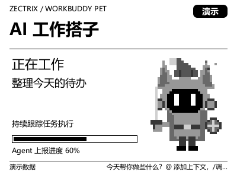
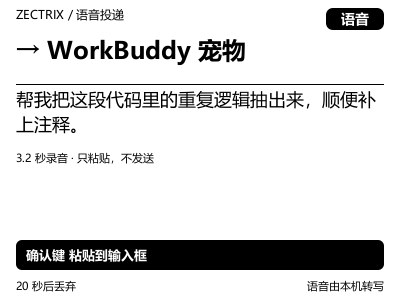
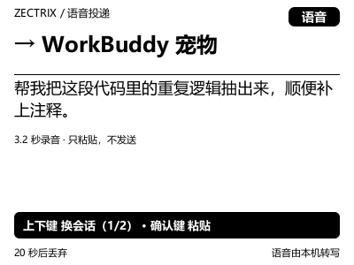
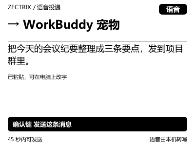
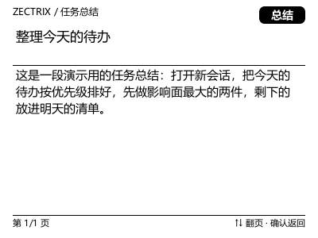
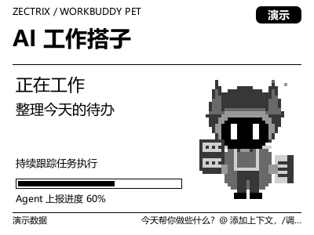
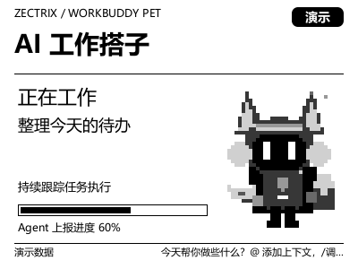
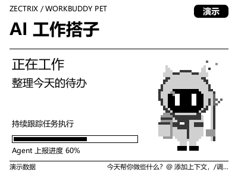
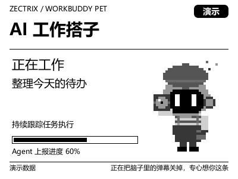
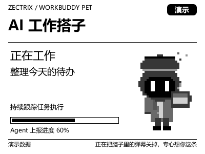

# WorkBuddy 宠物

**把 WorkBuddy 的实时状态放到桌角那块墨水屏上——抬头就能看见它在干活、在等你，还是要你拍板。**

Windows 本机小工具，只读本机会话文件，局域网直连设备。不上传数据，不写系统目录，不需要账号。

`Windows 10 / 11 x64` · `v0.5.1` · `MIT` · 单文件 5.8 MB，无 .NET / VC++ / Rust 运行时依赖

<p align="center">
  
</p>

<p align="center"><sub>设备上真实绘制的一帧（400×300），由 <code>preview --demo working</code> 渲染</sub></p>

- **六套造型，六种表情**——像素喵 / 金算喵 / 暴富喵 / 星际喵 / 镜头喵 / 拿铁喵，设备上长按上/下直接换。
- **按住确认键说话，再按一次发送**——两次确认：先粘进输入框，再回车发出，全程不碰键盘。音频不出本机。
- **完成后翻页看总结**——AI 最后那段结论推到设备，↑↓ 翻页读完，不用切回电脑。
- **状态自己会跟**——正在工作、等你确认、任务完成、空闲待命，不用切窗口，也不用刷手机。

---

## 目录

- [快速开始](#快速开始) — 装一次就能跑，含验收清单
- [语音输入](#语音输入) — 按住确认键说话，再按一次发送
- [任务总结](#任务总结) — 完成后翻页看 AI 的结论
- [六套造型](#六套造型)
- [设备按键](#设备按键)
- [命令速查](#命令速查)
- [屏幕什么时候亮](#屏幕什么时候亮) — 设备占用规则
- [它读什么、不读什么](#它读什么不读什么) — 隐私边界
- [完整部署](#完整部署) — 三种安装方式
- [前置条件与常见坑](#前置条件与常见坑) — 部署前先看
- [排错](#排错)
- [数据与卸载](#数据与卸载)
- [开发](#开发)

## 快速开始

**先在设备上确认两件事**（这两步程序替不了）：

1. 设备与电脑连**同一个 Wi-Fi**。
2. 打开「设置 → 网络同步 → **待机保持 Wi-Fi**」。不开时设备空闲约 2 分钟就掉线，推送一定失败。
   同一页面能看到**设备 IP**，可以先记下来（不记也行，程序能自动发现）。

**下载并改名**：从 [Releases](https://github.com/MuskCheng/zectrix-workbuddy-pet/releases/latest)
下载 `workbuddy-pet-0.5.1-windows-x64.exe`，**重命名为 `workbuddy-pet.exe`**——下文所有命令都用这个名字。
首次运行时 Windows 可能弹「已保护你的电脑」，点「更多信息 → 仍要运行」（exe 没有代码签名，属正常）。

### 推荐：一条命令走完

```powershell
cd "$env:USERPROFILE\Downloads"     # 下载到别的目录就换成那个目录
.\workbuddy-pet.exe init
```

`init` 会依次打印配置现状、连设备（**不写 IP 也会自动发现，最多 5 秒**）、电量与信号、渲染预览图，
然后只用你答两个问题（提前把 WorkBuddy 打开一次，它要读会话目录）：

```
先打开上面的预览确认版式，然后把它推到设备？ [y/N]
登录 Windows 时自动在后台运行？ [y/N]
```

都答 `y` 即可。预览图存在 `%LOCALAPPDATA%\zectrix-workbuddy-pet\out\pet-init.png`，
想先看一眼再决定就答 `n`，看完重跑 `init`。

### 或者分三步手动来

```powershell
cd "$env:USERPROFILE\Downloads"

# 1. 只核对设备（电量、信号、灰阶），不推画面
.\workbuddy-pet.exe check --target <设备IP>

# 2. 推一帧看看版式（check 刚断开，固件要 8 秒才释放连接）
Start-Sleep 9
.\workbuddy-pet.exe push --target <设备IP>

# 3. 交给它自己跑：装副本、写自启、注册计划任务、立刻起看门狗
.\workbuddy-pet.exe autostart on --target <设备IP>
```

`--target` 可以省略：`check` / `push` / `init` 不带地址时会用 mDNS 自动发现，局域网里只有一台设备时最省事；
发现成功后地址写进 `state.json`，之后连 `--target` 都不用写。

看到设备刷出宠物就算装好了。`autostart on` 会把程序复制到 `%LOCALAPPDATA%\zectrix-workbuddy-pet\bin\`，
写入开机自启、注册计划任务并立刻拉起看门狗——关掉终端也会继续工作。

### 验收：四行关键项都要对上

```powershell
cd "$env:LOCALAPPDATA\zectrix-workbuddy-pet\bin"
.\workbuddy-pet.exe autostart status
```

```
自启项：已启用（C:\Users\你\AppData\Roaming\Microsoft\Windows\Start Menu\Programs\Startup\zectrix-workbuddy-pet.vbs）
计划任务：已注册（zectrix-workbuddy-pet，每分钟检查一次，由任务计划服务托管）
守护程序：C:\Users\你\AppData\Local\zectrix-workbuddy-pet\bin\workbuddy-pet.exe
看门狗：运行中（pid 19100，心跳 4 秒前）
守护进程：运行中（pid 37124，心跳 5 秒前）
保存的目标：192.168.1.100
当前造型：像素喵（pixel）
WorkBuddy 进程：正在运行
```

| 行 | 应为 | 不对怎么办 |
| --- | --- | --- |
| 自启项 | 已启用 | 重跑 `autostart on` |
| 计划任务 | **已注册** | 重跑 `autostart on` 看报错；被策略拦住见[前置条件](#前置条件与常见坑)第 4 条 |
| 看门狗 | 运行中，心跳 < 20 秒 | `autostart off` → `autostart on` |
| 守护进程 | 运行中，心跳 < 20 秒 | 等 20 秒让看门狗补；仍不在就 `autostart off` → `autostart on` |

**「计划任务」这行最容易被当成可选项，其实不是**：缺了它守护仍能开机自启，但被 WorkBuddy hook
拉起来的那几份活不过一个回合，表现是日志每隔几分钟一条「守护进程启动」、设备间歇性掉线。

### 装完之后：三条自检

下面的命令都在安装副本所在目录执行（新开终端时先 `cd` 过去）：

```powershell
cd "$env:LOCALAPPDATA\zectrix-workbuddy-pet\bin"
# ① 只有一个 watch、一个 supervise（出现两个 watch 就是旧版双开）
tasklist | findstr workbuddy-pet

# ② 日志里没有成串的「设备忙碌」（-Encoding UTF8 不能省，否则中文全是乱码）
Get-Content "$env:LOCALAPPDATA\zectrix-workbuddy-pet\watch.log" -Tail 20 -Encoding UTF8

# ③ 能列出正在跑的会话，推导状态与侧边栏一致
.\workbuddy-pet.exe sessions
```

三条都正常，就可以放着不用管了：之后只在有任务时占设备，任务结束 5 分钟自动交还。

## 语音输入

设备麦克风只负责采集，**没有语音识别**；WorkBuddy 输入框也只收文字。所以音频传到电脑后
由本机 whisper 转写，再把文字送进输入框——**音频不出本机，不走云端**。

**两步确认，全程不用键盘**：第一次按确认键只粘贴，看一眼没错再按一次才发送。

```
长按确认键 1 秒 → 设备开始录音（顶部「正在聆听 / 松开结束」）
   ↓ 松开
「正在识别…」→ 本机转写
   ↓
确认页：识别文本 + 目标会话
   确认短按 = 粘进输入框（这一刻还没发出去）
   多个会话时 ↑/↓ 短按切换（最多 8 个近期会话）
   ↓ 再按一次确认
回车发送 → 回到主界面
   45 秒内没按第二次 = 放弃发送，文字仍留在输入框里，可以去电脑上手动发或删掉
```

<table>
  <tr>
    <td align="center"><br><b>① 识别完：确认键粘贴</b><br>文字先只进输入框</td>
    <td align="center"><br><b>多会话：上下键切换</b><br>底部显示当前是第几个</td>
    <td align="center"><br><b>② 已粘贴：再按一次发送</b><br>黑条只剩一件事</td>
  </tr>
</table>

*图中为本地渲染的真实版式（`voice preview`、`voice preview --pasted`），不是示意稿。
没有可选会话时标题显示「→ 当前窗口」，文字直接贴到当前输入框。*

四件事先说清楚：

1. **只在设备被占用时可用**（有任务在跑）。录音只能由设备发起、且必须连着；任务结束交还设备后，按键到不了程序。
2. **两次确认**：第一次粘贴、第二次发送。中间可以抬头看电脑、改错字——第二次只按回车，**不会重新粘贴**，改过的内容保留。
3. **需要一次性装 Python + whisper**（见[前置条件](#前置条件与常见坑)第 9 条）。没装也能用宠物，只是转不出字。
4. 模型会在设备亮起后自动预热，**松手到出字通常 1 秒内**；只有第一次安装（要下载约 1.5 GB）才会明显等。纯噪声或误触不会插入任何文字。

## 任务总结

任务完成时，设备不只知道「完成了」，还能把 AI 最后那段结论带到手边：

- 完成页把**总结的第一行**直接显示在任务名下面，不按键也能看到结论开头；
- 右下角提示「↓ 看总结」，短按下键进入总结页；
- 总结页用 **↑/↓ 翻页**（最多 8 页，每页 7 行），**确认键退出**；末页再按下也退出；
- 只取**最后一轮**的助手回复，压成纯文本（去掉标题符号、加粗、行内代码、代码块、链接地址，
  表格竖线换成「 · 」），按 400px 宽度折行。

<p align="center"></p>

<p align="center"><sub>本地渲染的真实版式：<code>preview --demo done --summary 0</code></sub></p>

正文**只在内存里**：不写 `state.json`、不落日志，关掉开关后连读取都不做。

```powershell
.\workbuddy-pet.exe summary off    # 关闭；完成页只显示「任务完成」
.\workbuddy-pet.exe summary on     # 重新开启（默认就是开的）
.\workbuddy-pet.exe summary show   # 本地预览当前任务的总结分页，调版式用
```

## 六套造型

<table>
  <tr>
    <td align="center"><br><b>像素喵</b> <code>pixel</code>（默认）<br>针织尖帽 · 光剑与圆盾</td>
    <td align="center"><br><b>金算喵</b> <code>abacus</code><br>连帽衫 · 算盘与账本</td>
    <td align="center"><br><b>暴富喵</b> <code>fortune</code><br>机能外套 · 大耳机 · 金条</td>
  </tr>
  <tr>
    <td align="center"><br><b>星际喵</b> <code>astro</code><br>宇航服 · 头盔 · 猫爪旗</td>
    <td align="center"><br><b>镜头喵</b> <code>lens</code><br>毛线帽 · 条纹衫背带裤 · 旁轴相机</td>
    <td align="center"><br><b>拿铁喵</b> <code>latte</code><br>针织帽 · 围巾马甲 · 一杯手冲</td>
  </tr>
</table>

*六套造型共用同一套骨架与六种状态表情，只换帽子、服装与道具。图中为 `preview --demo working`
的演示数据，原尺寸 400×300。设备上长按上/下键循环切换，立即存盘；也可以用 `skin set` 指定。*

## 设备按键

设备连着时有效（任务在跑、设备被占用）：

| 手势 | 作用 |
| --- | --- |
| 短按 上 / 下 | 翻任务；**总结页里翻页**；语音确认页里换目标会话 |
| 短按 确认 | 回首页并恢复自动跟随；**总结页里退出**；语音确认页里粘贴，**已粘贴时再按一次发送** |
| **长按 上 / 下** | 换宠物造型（六只循环，立即存盘） |
| **长按 确认** | 开始录音，松开结束（固件行为） |

任务交还设备后按键到不了程序，属正常。屏幕上正显示「待办通知」时，长按确认会被固件解释成
「完成待办」而不是录音。

## 命令速查

| 命令 | 用途 |
| --- | --- |
| `init` | 首次使用引导：检查配置 → 连设备（不填 IP 自动发现）→ 预览 → 确认推送 → 自启 |
| `check [--target <IP>]` | 只核对设备（电量、信号、灰阶），不推画面；省 IP 自动发现 |
| `push [--demo <状态>] [--skin <id>] [--target <IP>]` | 推一帧当前画面；`--demo` 用演示数据 |
| `preview [--demo <状态>] [--skin <id>] [--summary 页码] [--out 路径]` | 本地渲染 PNG，不连设备 |
| `autostart on [--target <IP>]` / `off` / `status` | 开启 / 关闭跟随、查看状态 |
| `skin list` / `skin set <id>` / `skin current` | 查看 / 切换造型（守护下一帧生效） |
| `summary on` / `off` / `show` | 开关「完成后翻页看总结」；`show` 预览分页结果 |
| `voice doctor [--wav 路径]` | 检查语音环境，可顺带试转一段音频 |
| `voice preview [--text 文本] [--pasted] [--out 路径]` | 本地渲染语音确认页（`--pasted` 出「已粘贴待发送」那版） |
| `voice targets` | 查看当前能投给哪些会话、顺序如何 |
| `sessions` | 列出可跟随的会话及推导状态（诊断） |
| `ensure [--verbose]` | 看门狗入口：守护不在就拉起，幂等 |
| `run` / `watch` / `supervise` | 调试用：常驻推图 / 守护 / 看门狗 |
| `where` / `forget` | 显示数据路径 / 清空本机状态缓存 |

**造型 id**：`pixel` 像素喵（默认）｜`abacus` 金算喵｜`fortune` 暴富喵｜`astro` 星际喵｜
`lens` 镜头喵｜`latte` 拿铁喵。
`skin set` 写进 `state.json`，不用重启；`--skin` 只是临时试看，不落盘。

完整参数与行为细节见 [USAGE.md](USAGE.md)。

## 屏幕什么时候亮

一台设备同一时刻只允许一个连接，所以守护按任务开关设备，而不是一直占着：

| 阶段 | 守护在做什么 | 设备 |
| --- | --- | --- |
| WorkBuddy 没开 | 每 5 秒看一眼进程，不碰设备 | 完全空闲 |
| 待命（已开、无任务） | 只读会话文件推断状态，**不连接** | 完全空闲，停在最后一帧 |
| 有任务在跑 | 连接、推送、翻页、响铃 | 被占用 |
| 等你确认 / 等你回答 | 保持连接，画面停在等待页，响一次提示音 | 被占用（直到处理完） |
| 一轮答完 | 再守 5 分钟（可调），没有新会话就交还 | 期内占用，期满交还 |

几点容易误会的地方：

- **交还设备不会清屏**。墨水屏断电保留最后一帧，完成画面会一直停在那里。
- **「等你确认」一直占用**。确认卡、提问都是在等人回电脑，设备就是这条通知的出口。
- 释放前还会确认「正在跟随的会话文件 30 秒内没再增长」，避免对方还在写日志时把连接撤掉。
- `--idle-grace 120` 改宽限秒数，`0` 表示任务一结束就交还。值存进 `state.json`。
- 定时任务（后台自动化）不上屏、不算任务，否则设备会被长期占住交还不了。

## 它读什么、不读什么

只读本机三处，**只取元数据，不读取、不保存、不上传对话正文、推理、工具参数或代码**：

| 来源 | 取什么 |
| --- | --- |
| `~/.workbuddy/projects/<项目>/<会话>.jsonl` | 轮次开始、提问/计划确认、助手消息状态、待办清单条目 |
| `~/.workbuddy/logs/main.log` | `[TaskNotify] pending/completed`：提问与权限确认卡的权威信号 |
| `~/.workbuddy/workbuddy.db` | 侧边栏会话名、上下文占用 |

**唯一的例外是任务总结**（`summary on` 时，默认开）：任务完成后读**最后一轮**助手回复的正文，
压成纯文本、截断到 1200 字，**只放在内存里**给设备翻页看——不写 `state.json`、不进日志、
不上传；下一轮开始即清空，`summary off` 后连读取都不做。这是唯一会碰到正文的地方，明写在这里。

状态只认明确记录，不做推测：新轮次 → 正在工作；有未答复的提问或确认卡 → 等你处理；会话尾部是
已完成的助手消息且静默 8 秒 → 任务完成；被中断 → 已停止；超过 15 分钟无更新 → 状态待确认（绝不自动判成功）。

## 完整部署

### 方式 A：直接下载（最快，推荐给只用不开发的人）

到 [Releases](https://github.com/MuskCheng/zectrix-workbuddy-pet/releases/latest) 下载
`workbuddy-pet-0.5.1-windows-x64.exe`，约 5.8 MB，静态链接单文件——**不需要 Rust、CMake、
Visual Studio，也不需要克隆 SDK**。

1. 重命名为 `workbuddy-pet.exe`（下文命令都用这个短名字）。
2. 首次运行若弹「Windows 已保护你的电脑」，点「更多信息 → 仍要运行」。
3. 想核对完整性（可选）：

```powershell
(Get-FileHash .\workbuddy-pet-0.5.1-windows-x64.exe -Algorithm SHA256).Hash
```

与同页 `SHA256SUMS.txt` 里的值对比（只在文件还没改名时能用这个字面名）。然后回到[快速开始](#快速开始)。

程序不做安装、不写注册表；所有运行数据只在 `%LOCALAPPDATA%\zectrix-workbuddy-pet\`。

### 方式 B：脚本一键构建 + 部署

```powershell
git clone https://github.com/MuskCheng/zectrix-workbuddy-pet.git
cd zectrix-workbuddy-pet
powershell -ExecutionPolicy Bypass -File scripts\install.ps1                  # 只构建与测试
powershell -ExecutionPolicy Bypass -File scripts\install.ps1 -DeviceIp <IP>   # 再检查设备、推图、开启跟随
```

成功判定（三条同时成立）：末尾打印 `DONE`；`target\release\workbuddy-pet.exe` 存在（约 5 MB）；
测试全部 `ok`、`0 failed`（另有 1 项 `ignored` 需要设备在线，通过数随版本增长）。

<details>
<summary>脚本失败时怎么定位（退出码对照）</summary>

| 退出码 | 含义 |
| --- | --- |
| `1` | 工具链缺失，脚本会列出 winget 命令，装完重开终端 |
| `2` | SDK 克隆失败（网络或代理） |
| `3` | 构建失败，多为 MSVC 缺 C++ 组件 |
| `4` | 测试失败 |
| `5` | 产物缺失 |
| `6` | 连不上设备 |

</details>

### 方式 C：手动编译

`Cargo.toml` 用 path 依赖 `../zectrix-local-push-sdk`，**两个仓库必须并排**，只克隆本仓库会编译失败。

```powershell
winget install --id Rustlang.Rustup -e
winget install --id Kitware.CMake -e
winget install --id Git.Git -e
winget install --id Microsoft.VisualStudio.2022.BuildTools -e --override "--wait --passive --add Microsoft.VisualStudio.Workload.VCTools --includeRecommended"

git clone https://github.com/MuskCheng/zectrix-workbuddy-pet.git
git clone https://github.com/itopinion/zectrix-local-push-sdk.git   # 必须与上个仓库同级
cd zectrix-workbuddy-pet
$env:CMAKE_POLICY_VERSION_MINIMUM = '3.5'
cargo test  --locked --release
cargo build --locked --release      # 产物 target\release\workbuddy-pet.exe
```

首次构建需联网拉依赖并编译 SDK 内置的 Opus，约 3–8 分钟。CMake 4.x 必须设
`CMAKE_POLICY_VERSION_MINIMUM=3.5`，否则旧版 Opus 脚本直接报错。

## 前置条件与常见坑

这几件事程序替不了，**部署前先确认**，否则表现为「装好了但设备没画面」。

1. **在设备上打开「待机保持 Wi-Fi」**：设置 → 网络同步 → 待机保持 Wi-Fi（固件 3.7.5 显示为「联网保持」）。
   不开时设备空闲约 2 分钟就从 Wi-Fi 下线，`ping` 和 `arp` 都找不到它。若坚持不开，只能在设备上点
   「连接管理端」主动连过来；本程序暂未监听该请求。
2. **设备 IP 在同一页面显示**，`<IP>` 一律替换成它；不带 `--target` 时程序会自动发现（mDNS，最多 5 秒），
   只有一台设备时可以不填。IP 变了要重跑 `autostart on --target <新IP>`。
3. **设备同时只允许一个连接**：断开后固件约 8 秒才释放租约。两条命令连着跑会报「设备忙碌」，隔 8 秒重试即可。
   守护运行期间手动 `check` / `push` 必然报忙碌，这是正常的（连接被守护占着），不是故障。
4. **守护只允许一份，而且得由计划任务托管**。0.4.3 起用命名互斥体保证单实例，重复执行 `autostart on`
   或 `ensure` 不会多起进程。0.4.4 起 `autostart on` 会额外注册计划任务 `zectrix-workbuddy-pet`
   （每分钟触发一次 `supervise`，已在跑则忽略）。少了这个任务，被 WorkBuddy hook 拉起来的守护
   活不过一个回合——它会跟着 hook 的作业对象一起被清理，日志里没有任何收尾。
   **装完务必用 `autostart status` 确认「计划任务：已注册」**；若那行显示未注册且重跑仍失败，
   多半是企业策略/终端沙箱禁止调用 `schtasks`，此时程序仍可用，只是守护被杀后要等下次发消息才恢复。
5. **exe 要在终端里跑，双击没反应**：不带参数启动只会打印用法。用 PowerShell / cmd 进入所在目录后
   `.\workbuddy-pet.exe init`（PowerShell）或 `workbuddy-pet.exe init`（cmd）。
6. **升级要先停再换**：`autostart off` → 覆盖 exe → `autostart on`。直接 `autostart on` 也会尝试热替换，
   但旧进程仍占用副本文件时会**静默沿用旧版**，看起来升级成功其实没换。换完用
   `.\workbuddy-pet.exe --version` 确认版本号变了。
7. **支持范围**：Windows 10/11 **x64**；设备仅 Note 4（`zectrix-s3-epaper-4.2`，400×300），**不支持 Note 4C**；
   固件 3.7.5（`zectrix-sdk` 0.2.0 配套），3.7.2 实测可连。不需要管理员权限，不需要极趣云 API Key。
8. **PowerShell 里带空格的路径要 `&`**：`& "C:\路径\workbuddy-pet.exe" check`，直接写路径会被当成字符串。
   用 `%LOCALAPPDATA%` 这类 cmd 变量也会报「无法加载模块」，PowerShell 里写 `$env:LOCALAPPDATA`。
9. **语音输入要自己装 Python（可选）**：设备录音只是音频，转文字发生在本机，需要 Python 3.12 +
   `faster-whisper`（装不上时自动回退 `openai-whisper`）。不装也能正常用，只是长按确认键录音后转不出字。

   ```powershell
   winget install --id Python.Python.3.12 -e
   $py = "$env:LOCALAPPDATA\Programs\Python\Python312\python.exe"
   & $py -m pip install faster-whisper     # 推荐：快 4～8 倍，自带 VAD
   & $py -m pip install openai-whisper     # 可选：faster-whisper 缺失时的回退
   .\workbuddy-pet.exe voice doctor        # 首次会下载 large-v3-turbo（约 1.5 GB）
   ```

   模型默认 `large-v3-turbo`（中文明显好于 small）。GPU 走 CUDA fp16，显存不够或 cuDNN 不匹配时
   自动退 CPU int8，短句仍能在 1 秒内出字。`voice doctor` 会把解释器、脚本、模型逐项打出来，
   哪一步缺了直接说清楚。

## 排错

| 现象 | 处理 |
| --- | --- |
| 日志反复「没有发现可用设备」，IP 没变 | 设备已从 Wi-Fi 下线：`ping <IP>` 与 `arp -a` 都查不到就确认了，去开「待机保持 Wi-Fi」 |
| 「设备忙碌」，且只出现一次、重连即成功 | 正常：固件释放租约要 8 秒。要手动推图先 `autostart off` |
| 「设备忙碌」连续多次、间隔 15→30→45→60 秒递增 | 旧版可能同时跑了两份守护。`tasklist \| findstr workbuddy-pet` 看到两个 `watch` 就是它，升级到最新版 |
| 守护在跑、看门狗「已停止」 | 重跑 `autostart on`；hook 触发时也会补 |
| 升级后功能没变 | 副本被旧进程占用导致沿用旧版：`autostart off` → 覆盖 exe → `autostart on`，再比对 SHA256 |
| PowerShell 报「意外的标记」 | 带空格/引号的路径不能当命令，用 `& "完整路径\workbuddy-pet.exe"` 或先 `cd` |
| 长按确认没反应 | 设备未被占用（任务已结束、已交还），或当前画面是待办通知（固件会当成完成待办） |
| 按 ↓ 进不了总结 | 只有「完成」态且这一轮有回复才可翻页；`summary off` 也会关掉。用 `summary show` 看本地能不能取到
| 第二次按确认没发送 | 多半是焦点被别的窗口抢了：屏幕上会显示「发送失败：…」，点一下 WorkBuddy 再按一次；文字仍在输入框
| 语音粘贴后过一会儿屏幕回到主界面 | 45 秒没按第二次，草稿弃了但**文字还在输入框**，去电脑上补一下回车即可 |
| 录音后转不出字 | 跑 `voice doctor`：没装 Python / whisper 会直接报；首次录音需等约 6 秒载模型 |
| 文字粘到了别的窗口 | 投递要求 WorkBuddy 在前台，抢不到前台会放弃而不是硬粘。点一下 WorkBuddy 再按确认 |
| 屏幕停在一条侧边栏已经删掉的任务上 | 0.4.5 起已按 `sessions.deleted_at` 过滤；旧版升级后重启守护即退场（日志会打印「会话已删除，退场」） |
| 日志每隔几分钟就「守护进程启动」，且没有「已断开并保存状态」 | 进程被 WorkBuddy 的 hook 作业对象清理了。看 `autostart status` 的「计划任务」是否为已注册，未注册就重跑 `autostart on` |
| 设备停在旧画面 | 系统通知会临时覆盖约 12 秒；`push` 打印「已推送」即设备报告显示完成 |

## 数据与卸载

设置、任务记录、录音与日志都在 `%LOCALAPPDATA%\zectrix-workbuddy-pet\`（含 `state.json`、
`watch.log`、`out\recordings\`）。程序不写注册表、不装服务，删掉这个目录就等于卸干净。

```powershell
cd "$env:LOCALAPPDATA\zectrix-workbuddy-pet\bin"
.\workbuddy-pet.exe autostart off   # 停看门狗与守护、删自启项与计划任务
```

`off` 的顺序是先停看门狗再停守护（反了会被 10 秒内补回来），0.4.4 起还会 `schtasks /end` +
`/delete` 掉计划任务。跑完删掉 `%LOCALAPPDATA%\zectrix-workbuddy-pet` 即完全清干净。
升级则不用卸载：设置与任务记录都在 `state.json` 里保留。

## 开发

```powershell
$env:CMAKE_POLICY_VERSION_MINIMUM = '3.5'
cargo test --release        # 60 项单元测试 + 13 项集成测试（另有 1 项需真机，ignored）
cargo clippy --all-targets
cargo build --release
```

- 画布与版式在 `src/layout.rs`（400×300，灰阶 16 级），造型与骨架在 `src/sprite.rs`。
- 会话状态推导在 `src/workbuddy.rs`，只读 `~/.workbuddy` 下的元数据。
- 语音链路在 `src/voice.rs`，转写进程脚本见 `scripts/asr_worker.py`。
- 发版：改 `Cargo.toml` 版本，**同时改 README 里三处**（元信息行的 `vX.Y.Z`、快速开始与
  完整部署里的下载文件名）→ 提交 → `git tag vX.Y.Z` → 上传 exe 与 `SHA256SUMS.txt`。
  漏改文件名会让新用户照着文档去下载一个不存在的文件。

## 许可

MIT。设备通道使用 [zectrix-local-push-sdk](https://github.com/itopinion/zectrix-local-push-sdk) 0.2.0（MIT）。
本仓库不复制、不修改、不携带 SDK 与固件；固件升级请按官方指引自行操作。
