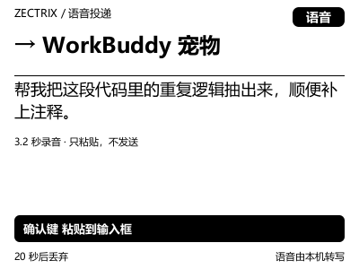
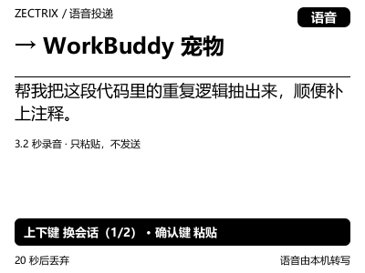

# WorkBuddy 宠物

**把 WorkBuddy 的实时状态放到桌角那块墨水屏上——抬头就能看见它在干活、在等你，还是要你拍板。**

Windows 本机小工具，只读本机会话文件，局域网直连设备。不上传数据，不写系统目录，不需要账号。

`Windows 10 / 11 x64` · `v0.4.3` · `MIT` · 单文件 5.4 MB，无 .NET / VC++ / Rust 运行时依赖

<p align="center">
  
</p>

<p align="center"><sub>设备上真实绘制的一帧（400×300），由 <code>preview --demo working</code> 渲染</sub></p>

- **四套造型，六种表情**——像素喵 / 金算喵 / 暴富喵 / 星际喵，设备上长按上/下直接换。
- **按住确认键说话**——设备麦克风采集，本机 whisper 转写，粘贴进你选中的会话输入框。音频不出本机。
- **状态自己会跟**——正在工作、等你确认、任务完成、空闲待命，不用切窗口，也不用刷手机。

---

## 目录

- [快速开始](#快速开始) — 三步跑起来
- [语音输入](#语音输入) — 按住确认键说话
- [四套造型](#四套造型)
- [设备按键](#设备按键)
- [命令速查](#命令速查)
- [屏幕什么时候亮](#屏幕什么时候亮) — 设备占用规则
- [它读什么、不读什么](#它读什么不读什么) — 隐私边界
- [完整部署](#完整部署) — 三种安装方式
- [前置条件与常见坑](#前置条件与常见坑) — 部署前先看
- [排错](#排错)
- [数据与卸载](#数据与卸载)
- [开发](#开发)

## 快速开始

前提：设备与电脑在同一局域网，且已在设备上打开「设置 → 网络同步 → 待机保持 Wi-Fi」。
没开这条，设备空闲约 2 分钟就下线，推送一定失败。

```powershell
# 1. 下载 workbuddy-pet-0.4.3-windows-x64.exe 后，先核对设备通不通
.\workbuddy-pet.exe check --target <设备IP>

# 2. 推一帧看看版式（check 刚断开，固件要 8 秒才释放连接）
Start-Sleep 9
.\workbuddy-pet.exe push --target <设备IP>

# 3. 交给它自己跑
.\workbuddy-pet.exe autostart on --target <设备IP>
```

看到设备刷出宠物就算装好了。第 3 步会把程序复制到 `%LOCALAPPDATA%\zectrix-workbuddy-pet\bin\`，
写入开机自启，并立刻拉起看门狗——之后关掉终端也会继续工作。

验收：

```powershell
cd "$env:LOCALAPPDATA\zectrix-workbuddy-pet\bin"
.\workbuddy-pet.exe autostart status
```

```
自启项：已启用（...\Startup\zectrix-workbuddy-pet.vbs）
看门狗：运行中（pid 9868，心跳 2 秒前）
守护进程：运行中（pid 39976，心跳 2 秒前）
```

两行都在、心跳都在 20 秒内，就正常。看门狗显示「已停止」时重跑 `autostart on`。

## 语音输入

设备麦克风只负责采集，**没有语音识别**；WorkBuddy 输入框也只收文字。所以音频传到电脑后
由本机 whisper 转写，再把文字粘贴进去——**音频不出本机，不走云端**。

```
长按确认键 1 秒 → 设备开始录音（顶部「正在聆听 / 松开结束」）
   ↓ 松开
「正在识别…」→ 本机转写
   ↓
确认页：识别文本 + 目标会话
   确认短按 = 粘贴到输入框（不发送）
   多个会话时 ↑/↓ 短按切换（最多 8 个近期会话）
   20 秒不操作 = 丢弃
```

<table>
  <tr>
    <td align="center"><br><b>日常：只有一个会话</b><br>确认键直接粘贴</td>
    <td align="center"><br><b>多个会话：上下键切换</b><br>底部显示当前是第几个</td>
  </tr>
</table>

*图中为本地渲染的真实版式（`voice preview`），不是示意稿。没有可选会话时标题显示「→ 当前窗口」，
文字直接贴到当前输入框。*

四件事先说清楚：

1. **只在设备被占用时可用**（有任务在跑）。录音只能由设备发起、且必须连着；任务结束交还设备后，按键到不了程序。
2. **只粘贴、不发送**。文字进输入框后还能改错字，自己按回车。
3. **需要一次性装 Python + whisper**（见[前置条件](#前置条件与常见坑)第 8 条）。没装也能用宠物，只是转不出字。
4. 首次要载模型（turbo 首次还要下载约 1.5 GB），之后每段 1 秒内出字。纯噪声或误触不会插入任何文字。

## 四套造型

<table>
  <tr>
    <td align="center"><br><b>像素喵</b> <code>pixel</code>（默认）<br>针织尖帽 · 光剑与圆盾</td>
    <td align="center"><br><b>金算喵</b> <code>abacus</code><br>连帽衫 · 算盘与账本</td>
  </tr>
  <tr>
    <td align="center"><br><b>暴富喵</b> <code>fortune</code><br>机能外套 · 大耳机 · 金条</td>
    <td align="center"><br><b>星际喵</b> <code>astro</code><br>宇航服 · 头盔 · 猫爪旗</td>
  </tr>
</table>

*四套造型共用同一套骨架与六种状态表情，只换帽子、服装与道具。图中为 `preview --demo working`
的演示数据，原尺寸 400×300。设备上长按上/下键循环切换，立即存盘；也可以用 `skin set` 指定。*

## 设备按键

设备连着时有效（任务在跑、设备被占用）：

| 手势 | 作用 |
| --- | --- |
| 短按 上 / 下 | 翻任务；语音确认页里则换目标会话 |
| 短按 确认 | 回首页并恢复自动跟随；语音确认页里则粘贴文字 |
| **长按 上 / 下** | 换宠物造型（四只循环，立即存盘） |
| **长按 确认** | 开始录音，松开结束（固件行为） |

任务交还设备后按键到不了程序，属正常。屏幕上正显示「待办通知」时，长按确认会被固件解释成
「完成待办」而不是录音。

## 命令速查

| 命令 | 用途 |
| --- | --- |
| `init` | 首次使用引导：检查配置 → 连设备 → 预览 → 确认推送 → 自启 |
| `check --target <IP>` | 只核对设备（电量、信号、灰阶），不推画面 |
| `push [--demo <状态>] [--skin <id>]` | 推一帧当前画面；`--demo` 用演示数据 |
| `preview [--demo <状态>] [--skin <id>] [--out 路径]` | 本地渲染 PNG，不连设备 |
| `autostart on [--target <IP>]` / `off` / `status` | 开启 / 关闭跟随、查看状态 |
| `skin list` / `skin set <id>` / `skin current` | 查看 / 切换造型（守护下一帧生效） |
| `voice doctor [--wav 路径]` | 检查语音环境，可顺带试转一段音频 |
| `voice preview [--text 文本] [--out 路径]` | 本地渲染语音确认页，用于调版式 |
| `voice targets` | 查看当前能投给哪些会话、顺序如何 |
| `sessions` | 列出可跟随的会话及推导状态（诊断） |
| `ensure [--verbose]` | 看门狗入口：守护不在就拉起，幂等 |
| `run` / `watch` / `supervise` | 调试用：常驻推图 / 守护 / 看门狗 |
| `where` / `forget` | 显示数据路径 / 清空本机状态缓存 |

**造型 id**：`pixel` 像素喵（默认）｜`abacus` 金算喵｜`fortune` 暴富喵｜`astro` 星际喵。
`skin set` 写进 `state.json`，不用重启；`--skin` 只是临时试看，不落盘。

完整参数与行为细节见 [USAGE.md](USAGE.md)。

## 屏幕什么时候亮

一台设备同一时刻只允许一个连接，所以守护按任务开关设备，而不是一直占着：

| 阶段 | 守护在做什么 | 设备 |
| --- | --- | --- |
| WorkBuddy 没开 | 每 5 秒看一眼进程，不碰设备 | 完全空闲 |
| 待命（已开、无任务） | 只读会话文件推断状态，**不连接** | 完全空闲，停在最后一帧 |
| 有任务在跑 | 连接、推送、翻页、响铃 | 被占用 |
| 等你确认 / 等你回答 | 保持连接，画面停在等待页，响一次提示音 | 被占用（直到处理完） |
| 一轮答完 | 再守 5 分钟（可调），没有新会话就交还 | 期内占用，期满交还 |

几点容易误会的地方：

- **交还设备不会清屏**。墨水屏断电保留最后一帧，完成画面会一直停在那里。
- **「等你确认」一直占用**。确认卡、提问都是在等人回电脑，设备就是这条通知的出口。
- 释放前还会确认「正在跟随的会话文件 30 秒内没再增长」，避免对方还在写日志时把连接撤掉。
- `--idle-grace 120` 改宽限秒数，`0` 表示任务一结束就交还。值存进 `state.json`。
- 定时任务（后台自动化）不上屏、不算任务，否则设备会被长期占住交还不了。

## 它读什么、不读什么

只读本机三处，**只取元数据，不读取、不保存、不上传对话正文、推理、工具参数或代码**：

| 来源 | 取什么 |
| --- | --- |
| `~/.workbuddy/projects/<项目>/<会话>.jsonl` | 轮次开始、提问/计划确认、助手消息状态、待办清单条目 |
| `~/.workbuddy/logs/main.log` | `[TaskNotify] pending/completed`：提问与权限确认卡的权威信号 |
| `~/.workbuddy/workbuddy.db` | 侧边栏会话名、上下文占用 |

状态只认明确记录，不做推测：新轮次 → 正在工作；有未答复的提问或确认卡 → 等你处理；会话尾部是
已完成的助手消息且静默 8 秒 → 任务完成；被中断 → 已停止；超过 15 分钟无更新 → 状态待确认（绝不自动判成功）。

## 完整部署

### 方式 A：直接下载（最快）

到 [Releases](https://github.com/MuskCheng/zectrix-workbuddy-pet/releases/latest) 下载
`workbuddy-pet-0.4.3-windows-x64.exe`，约 5.4 MB，静态链接单文件。

可选核对完整性：

```powershell
(Get-FileHash .\workbuddy-pet-0.4.3-windows-x64.exe -Algorithm SHA256).Hash
```

与同页 `SHA256SUMS.txt` 对比。然后回到[快速开始](#快速开始)。

### 方式 B：脚本一键构建 + 部署

```powershell
git clone https://github.com/MuskCheng/zectrix-workbuddy-pet.git
cd zectrix-workbuddy-pet
powershell -ExecutionPolicy Bypass -File scripts\install.ps1                  # 只构建与测试
powershell -ExecutionPolicy Bypass -File scripts\install.ps1 -DeviceIp <IP>   # 再检查设备、推图、开启跟随
```

成功判定（三条同时成立）：末尾打印 `DONE`；`target\release\workbuddy-pet.exe` 存在（约 5 MB）；
测试全部 `ok`、`0 failed`（另有 1 项 `ignored` 需要设备在线，通过数随版本增长）。

<details>
<summary>脚本失败时怎么定位（退出码对照）</summary>

| 退出码 | 含义 |
| --- | --- |
| `1` | 工具链缺失，脚本会列出 winget 命令，装完重开终端 |
| `2` | SDK 克隆失败（网络或代理） |
| `3` | 构建失败，多为 MSVC 缺 C++ 组件 |
| `4` | 测试失败 |
| `5` | 产物缺失 |
| `6` | 连不上设备 |

</details>

### 方式 C：手动编译

`Cargo.toml` 用 path 依赖 `../zectrix-local-push-sdk`，**两个仓库必须并排**，只克隆本仓库会编译失败。

```powershell
winget install --id Rustlang.Rustup -e
winget install --id Kitware.CMake -e
winget install --id Git.Git -e
winget install --id Microsoft.VisualStudio.2022.BuildTools -e --override "--wait --passive --add Microsoft.VisualStudio.Workload.VCTools --includeRecommended"

git clone https://github.com/MuskCheng/zectrix-workbuddy-pet.git
git clone https://github.com/itopinion/zectrix-local-push-sdk.git   # 必须与上个仓库同级
cd zectrix-workbuddy-pet
$env:CMAKE_POLICY_VERSION_MINIMUM = '3.5'
cargo test  --locked --release
cargo build --locked --release      # 产物 target\release\workbuddy-pet.exe
```

首次构建需联网拉依赖并编译 SDK 内置的 Opus，约 3–8 分钟。CMake 4.x 必须设
`CMAKE_POLICY_VERSION_MINIMUM=3.5`，否则旧版 Opus 脚本直接报错。

## 前置条件与常见坑

这几件事程序替不了，**部署前先确认**，否则表现为「装好了但设备没画面」。

1. **在设备上打开「待机保持 Wi-Fi」**：设置 → 网络同步 → 待机保持 Wi-Fi（固件 3.7.5 显示为「联网保持」）。
   不开时设备空闲约 2 分钟就从 Wi-Fi 下线，`ping` 和 `arp` 都找不到它。若坚持不开，只能在设备上点
   「连接管理端」主动连过来；本程序暂未监听该请求。
2. **记下设备 IP**（同一页面显示），上文 `<IP>` 一律替换成它。IP 变了要重跑 `autostart on --target <新IP>`。
3. **设备同时只允许一个连接**：断开后固件约 8 秒才释放租约。两条命令连着跑会报「设备忙碌」，隔 8 秒重试即可。
   守护运行期间手动 `check` / `push` 必然报忙碌，这是正常的（连接被守护占着），不是故障。
4. **守护只允许一份**。`autostart on` 与 `ensure` 都幂等，重复执行不会多起进程；0.4.3 起用命名互斥体保证，
   第二份会打印「已有守护在跑」后退出。若在旧版看到两个 `watch`，就是本节说的双开，升级即可。
5. **升级要先停再换**：`autostart off` → 覆盖 exe → `autostart on`。直接 `autostart on` 也会尝试热替换，
   但旧进程仍占用副本文件时会**静默沿用旧版**，看起来升级成功其实没换。
6. **支持范围**：Windows 10/11 **x64**；设备仅 Note 4（`zectrix-s3-epaper-4.2`，400×300），**不支持 Note 4C**；
   固件 3.7.5（`zectrix-sdk` 0.2.0 配套），3.7.2 实测可连。不需要管理员权限，不需要极趣云 API Key。
7. **PowerShell 里带空格的路径要 `&`**：`& "C:\路径\workbuddy-pet.exe" check`，直接写路径会被当成字符串。
8. **语音输入要自己装 Python（可选）**：设备录音只是音频，转文字发生在本机，需要 Python 3.12 +
   `faster-whisper`（装不上时自动回退 `openai-whisper`）。不装也能正常用，只是长按确认键录音后转不出字。

   ```powershell
   winget install --id Python.Python.3.12 -e
   $py = "$env:LOCALAPPDATA\Programs\Python\Python312\python.exe"
   & $py -m pip install faster-whisper     # 推荐：快 4～8 倍，自带 VAD 与热词
   & $py -m pip install openai-whisper     # 可选：faster-whisper 缺失时的回退
   .\workbuddy-pet.exe voice doctor        # 首次会下载 large-v3-turbo（约 1.5 GB）
   ```

   模型默认 `large-v3-turbo`（中文明显好于 small）。GPU 走 CUDA fp16，显存不够或 cuDNN 不匹配时
   自动退 CPU int8，短句仍能在 1 秒内出字。

## 排错

| 现象 | 处理 |
| --- | --- |
| 日志反复「没有发现可用设备」，IP 没变 | 设备已从 Wi-Fi 下线：`ping <IP>` 与 `arp -a` 都查不到就确认了，去开「待机保持 Wi-Fi」 |
| 「设备忙碌」，且只出现一次、重连即成功 | 正常：固件释放租约要 8 秒。要手动推图先 `autostart off` |
| 「设备忙碌」连续多次、间隔 15→30→45→60 秒递增 | 旧版可能同时跑了两份守护。`tasklist \| findstr workbuddy-pet` 看到两个 `watch` 就是它，升级到 0.4.3 |
| 守护在跑、看门狗「已停止」 | 重跑 `autostart on`；hook 触发时也会补 |
| 升级后功能没变 | 副本被旧进程占用导致沿用旧版：`autostart off` → 覆盖 exe → `autostart on`，再比对 SHA256 |
| PowerShell 报「意外的标记」 | 带空格/引号的路径不能当命令，用 `& "完整路径\workbuddy-pet.exe"` 或先 `cd` |
| 长按确认没反应 | 设备未被占用（任务已结束、已交还），或当前画面是待办通知（固件会当成完成待办） |
| 录音后转不出字 | 跑 `voice doctor`：没装 Python / whisper 会直接报；首次录音需等约 6 秒载模型 |
| 文字粘到了别的窗口 | 投递要求 WorkBuddy 在前台，抢不到前台会放弃而不是硬粘。点一下 WorkBuddy 再按确认 |
| 设备停在旧画面 | 系统通知会临时覆盖约 12 秒；`push` 打印「已推送」即设备报告显示完成 |

## 数据与卸载

设置、任务记录、录音与日志都在 `%LOCALAPPDATA%\zectrix-workbuddy-pet\`（含 `state.json`、
`watch.log`、`recordings\`）。

```powershell
.\workbuddy-pet.exe autostart off   # 停看门狗与守护、删自启项
```

`off` 会先停看门狗再停守护，否则看门狗 10 秒内会把守护补回来。之后删除该目录即完全清干净。
升级保留全部设置与任务记录。

## 开发

```powershell
$env:CMAKE_POLICY_VERSION_MINIMUM = '3.5'
cargo test --release        # 59 项单元测试 + 13 项集成测试
cargo clippy --all-targets
cargo build --release
```

- 画布与版式在 `src/layout.rs`（400×300，灰阶 16 级），造型与骨架在 `src/sprite.rs`。
- 会话状态推导在 `src/workbuddy.rs`，只读 `~/.workbuddy` 下的元数据。
- 语音链路在 `src/voice.rs`，转写进程脚本见 `scripts/asr_worker.py`。
- 发版：改 `Cargo.toml` 版本 → 提交 → `git tag vX.Y.Z` → 上传 exe 与 `SHA256SUMS.txt`。

## 许可

MIT。设备通道使用 [zectrix-local-push-sdk](https://github.com/itopinion/zectrix-local-push-sdk) 0.2.0（MIT）。
本仓库不复制、不修改、不携带 SDK 与固件；固件升级请按官方指引自行操作。
