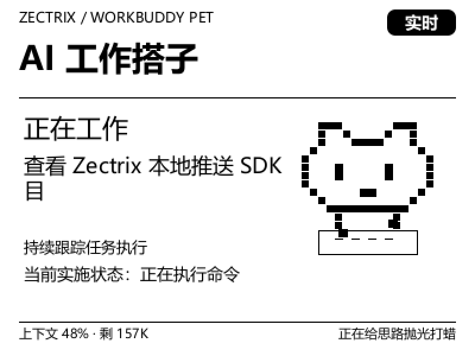

# WorkBuddy 宠物（ZECTRIX Note 4）



*实机画面 400×300（此处放大 2 倍展示）。上图为一次真实推送：任务进行中、
宠物在工作、底部是上下文占用与随机花絮。重新生成：`workbuddy-pet preview --out docs/preview.png`。*

把本机 WorkBuddy 的任务状态推到你桌上的墨水屏：一台 400×300 的电子纸显示一只像素宠物，
工作中它在动、需要你处理时它举牌、任务完成时它收工。程序在本机运行，直连局域网里的设备，
不经过任何云端。

- 状态来源：本机 `~/.workbuddy/projects/**/<会话>.jsonl` 与 `~/.workbuddy/logs/main.log`
- 设备通道：`zectrix-local-push-sdk`（zectrix-sdk 0.1.0）局域网直连
- 渲染：本机生成 400×300 PNG → SDK 按设备色板量化为 mono / gray4 / gray16（不重复抖色）

## 兼容性

| 项目 | 要求 |
| --- | --- |
| 设备 | ZECTRIX Note 4（`zectrix-s3-epaper-4.2`），画布 400×300 |
| 固件 | 3.7.2（`zectrix-sdk` 0.1.0 配套版本）。**不适用于 Note 4C**，也不承诺其他固件 |
| 系统 | Windows 10/11 x64（本机实测环境），需 Rust MSVC 工具链 |
| 网络 | 设备与电脑在同一局域网；设备上开启「设置 → 网络同步 → 待机保持 Wi-Fi」 |
| API Key | 本地直连**不需要**极趣云 API Key；本程序也不读取任何账号或密钥 |

不自动升级固件，不连接未指定的设备，不与其它程序抢同一台设备。

## 构建

前置：Rust（MSVC 工具链）、CMake、Visual Studio C++ Build Tools（SDK 的原生 Opus 需要）。
系统字体 `C:\Windows\Fonts\msyh.ttc` 与 `msyhbd.ttc` 用于渲染中文。

推送用的是官方 SDK，本项目**不复制也不修改**它，而是以路径依赖引用同一层目录里的克隆：

```bat
cd D:\repositories
git clone https://github.com/itopinion/zectrix-local-push-sdk.git
cd workbuddy-pet
set CMAKE_POLICY_VERSION_MINIMUM=3.5
cargo test --release
cargo build --release
```

`CMAKE_POLICY_VERSION_MINIMUM=3.5` 不能省：本机 CMake 4.x 对 SDK 内置的旧版 Opus 构建脚本
会报「Compatibility with CMake < 3.5 has been removed」。这是 SDK README 给的处理办法。

产物：`target\release\workbuddy-pet.exe`。

SDK 以路径依赖引用：`zectrix-sdk = { path = "../zectrix-local-push-sdk" }`。
本项目**不分发、不修改 SDK**，直接用官方仓库：

```bat
cd D:\repositories
git clone https://github.com/itopinion/zectrix-local-push-sdk.git
```

官方 SDK 放在哪都行，只要路径对得上 `Cargo.toml`（也可用 `mklink /J` 建一个目录联接
指向已有的官方克隆，本项目就是这么做的：`D:\repositories\zectrix-local-push-sdk`
是指向官方克隆的联接，不是副本）。

## 首次初始化

第一次使用跑一次引导，它会把配置逐项摆出来，再带你连上设备：

```bat
workbuddy-pet init
```

流程（每一步失败都不影响其它步骤，修正后重跑即可）：

1. **检查现状**：数据目录、状态缓存里有几个任务、WorkBuddy 会话目录与进程、
   已保存的设备地址、跟随/提示音/动画/灰阶设置
2. **连接设备**：不带 `--target` 时自动发现（最多 5 秒）；连上后打印型号、电量、
   信号，并把设备报告的地址存进 `state.json`（此后各命令都不必再带 `--target`）
3. **生成预览**：渲染一张 400×300 PNG 到 `%LOCALAPPDATA%\zectrix-workbuddy-pet\out\pet-init.png`，
   **先打开图确认版式**
4. **确认后再推送**：输入 `y` 才会上设备；`ResultUnknown` 不重试
5. **按需开机自启**：输入 `y` 才写启动项

常见失败与处理：`设备忙碌` → 已有守护在占用，先停掉再初始化（强杀后等约 15 秒）；
`没有发现可用设备` → 检查同一局域网、设备已开「待机保持 Wi-Fi」：
`发现多台设备` → 用 `--target <IP>` 指定其一。

> `init` 会在**你确认之后**才推送第一张画面；在此之前设备不会被动到。

## 快速开始

```bat
REM 0) 先核对设备：型号、电量、信号，不推画面
workbuddy-pet check --target 192.168.1.100

REM 1) 只看画面，不连设备（可加 --demo working|waiting|done|error 看状态版式）
workbuddy-pet preview
REM 输出：%LOCALAPPDATA%\zectrix-workbuddy-pet\out\pet-working.png

REM 2) 推一张当前状态，推完立即断开
workbuddy-pet push --target 192.168.1.100 --format gray16

REM 3) 常驻跟随：状态变化才刷屏，按键翻页，等待/完成播提示音
workbuddy-pet run --target 192.168.1.100

REM 4) 日常用守护：WorkBuddy 启动即待命，有任务才占用设备，任务结束后交还
workbuddy-pet watch --target 192.168.1.100
```

## 设备占用策略（重要）

一台设备同一时刻只允许一个连接，所以守护**不常驻占用**，而是按任务开关：

| 阶段 | 守护在做什么 | 设备状态 |
| --- | --- | --- |
| WorkBuddy 未启动 | 每 5 秒看一眼进程，不碰设备 | 完全空闲，随便别的程序用 |
| 待命（WorkBuddy 已启动、还没有任务） | 只读会话文件推断状态，**不连接设备** | 完全空闲 |
| 有任务（正在工作 / 等你处理） | 连上设备推送状态、按键翻页、等待/完成响铃 | 被守护占用 |
| 任务结束后 | 再守 `idle_grace` 秒（默认 300 = 5 分钟） | 5 分钟内没有新任务就 `close()` 交还 |

- **占有规则**：任务完成后 5 分钟内没有新任务下达，自动解除占用。这 5 分钟是给连续追问
  留的无缝衔接窗口——期内又发一条，就不用断开再重连；**完成画面不会因为交还设备而消失**：
  墨水屏断电后照样保留最后一帧。
- **调宽限**：`workbuddy-pet watch --idle-grace 120`（秒）。`--idle-grace 0` = 任务一结束
  就交还；值会存进 `state.json`，下次不用再带。
- **等你处理也算活跃任务**：确认卡没答完就一直占着，直到任务结束。但超过 15 分钟
  没有新动静会被判为「状态待确认」，此时同样交还设备——一张被遗忘的确认卡不该把设备
  锁到天荒地老。
- **断线不会反复抢设备**：设备休眠会导致 `Timeout` 断开，只在任务仍活跃时按 15 秒步长
  退避重连，连续失败 5 次就停下等下一个任务。
- 手动 `run` 默认一直占着（便于调试），需要同样的交还行为可加 `--standby`。

## 安装（开机自动跟随）

```bat
workbuddy-pet autostart on --target 192.168.1.100
```

会做三件事：

1. 在启动文件夹放 `zectrix-workbuddy-pet.vbs`（隐藏窗口，不弹黑框）
2. 生成 `%LOCALAPPDATA%\zectrix-workbuddy-pet\watch.cmd`（含设备地址，日志写 `watch.log`）
3. 把目标地址存进 `state.json`

设置完成后，登录 Windows 就会自动在后台等待 WorkBuddy；想立刻生效不必重启，
直接运行 `workbuddy-pet watch`。

## 停止 / 卸载 / 更新

- **停止**：前台运行时 `Ctrl+C`——会向设备发送 `close()`、保存状态后退出，不自动重连。
  后台守护用任务管理器结束 `workbuddy-pet.exe`；强杀后设备约 15 秒才释放租约（固件行为），
  这期间其它程序连不上属正常。
- **卸载**：`workbuddy-pet autostart off` → `workbuddy-pet forget` → 删除本项目目录与
  `%LOCALAPPDATA%\zectrix-workbuddy-pet`。不触碰 WorkBuddy 与设备上的任何数据。
- **更新**：`cd ..\zectrix-local-push-sdk && git pull`，再回本项目 `cargo build --release`。
  状态缓存保留；`state.json` 不会被覆盖。
- **数据**：`%LOCALAPPDATA%\zectrix-workbuddy-pet\state.json` 只存任务标题、状态、设置与
  设备地址。从早期 `pet4` 目录升级时会自动复制一份旧 `state.json`（只复制、不删源）。

## 命令

| 命令 | 作用 |
| --- | --- |
| `preview` | 渲染 400×300 PNG，不连设备；`--session <ID>` 只看该会话 |
| `scene` | 打印布局 JSON（调试版式用） |
| `sessions` | 列出可跟随的会话、推导状态与清单进度（诊断） |
| `check` | 核对设备型号/电量/信号，不推画面 |
| `sound` | 只播一次提示音：`--status waiting\|done` |
| `push` | 单次推送后断开 |
| `run` | 常驻跟随：状态变化才刷屏、按键翻页、提示音；`--standby` 任务结束即交还并退出 |
| `watch` | 守护：WorkBuddy 一启动就待命（不占设备），有任务才占用，任务结束交还（推荐日常） |
| `autostart` | 开机自启开关 |
| `where` / `forget` | 显示路径 / 删除本机状态缓存 |

## 按键

- `上/下`：多任务时翻页（每页 4 个，末页循环回首页）；任务 ≤4 个时选择任务
- `确认`：回到首页、恢复自动跟随（**不会**批准 Agent 的任何操作）

## 状态与画面

| 状态 | 画面 |
| --- | --- |
| 正在工作 | 宠物在动；无清单时显示「当前实施状态：正在修改文件 / 正在执行命令 …」 |
| 有清单 | 「任务清单 3/7 · 43%」+ 进度条 |
| 等你处理 | 题干（最多 2 行）+ 徽章「请回到电脑确认」+ 右下「设备仅作提示」，并响铃 |
| 任务完成 | 收工姿态 + 「完成！」，响铃一次 |

左下角显示「上下文 45% · 剩 164K」——当前会话的上下文占用，读
`~/.workbuddy/workbuddy.db` 的 `session_usage.used/size`，每 15 秒刷新，
整百分比变化才刷新屏幕。右下角是随任务变动轮换的花絮短语。

「等你处理」覆盖两类等待，信号源是 WorkBuddy 主进程写进
`~/.workbuddy/logs/main.log` 的 `[TaskNotify] pending: session=<id> kind=question|permission`：
提问题与**写入确认卡**都会提醒，且不论待确认发生在哪个会话。确认完成后立即恢复。

### 什么时候会响

- **状态真的变了**才响：工作 → 等你处理、工作 → 完成。同一状态被重复上报（进度、
  实施状态文字抖动）不会重复响。
- **开机/重连补一次**：程序刚启动、或设备超时后重连时，第一遍扫描是静默的（避免把历史
  回放当成新通知）；但如果此刻屏幕上正停在「等你处理」，会立刻补响一次——否则确认卡
  在没有提示音的情况下出现在屏幕上。刚完成 1 分钟内的任务同样补响。
- **同一条提醒只响一次**：提醒指纹（任务 + 上屏文案）写在 `state.json` 的 `announced`
  字段里，所以设备反复超时重连不会反复响；换一张确认卡、换一个提问、换一个任务会再响。
  `--no-sound` 或 `settings.sound_enabled=false` 可整体关闭。

## 隐私

- 只读 WorkBuddy 的会话元数据：任务状态、清单条目数与完成数、主进程的待确认事件
- 任务名取**每一轮用户提问的第一行**（最多 36 字），所以它跟着当前任务走；没有提问
  正文的旧会话退回会话标题/项目名
- 除上面这一行外，**不读取、不上屏**对话正文、工具参数、推理过程、文件内容、账号与密钥
- 服务与设备均在本机/局域网内，程序不向外发起任何请求
- 设备地址只存在本机 `state.json`；日志不打印密钥
- 注意：任务名会显示在设备上，别把敏感信息写进提问首行

## 已知边界

- **积分余额读不到**：设置页的「积分余额」是云端数据，本地磁盘/数据库/日志均无缓存
  （已逐处核对），设备上不再显示，改为显示可精确读取的上下文占用。
- **设备不能替你点电脑上的选项**：选项卡片只接受鼠标；模拟键盘能送达窗口但卡片无反应，
  UI Automation 被执行策略禁止。所以等待画面只提示「请回电脑确认」。
- **写入确认靠主进程事件**：权限卡不写会话记录，完全依赖 `main.log` 的 TaskNotify；
  若日志被清理或轮转到 512 KiB 之外，会回退到「写入工具卡住 10 秒」的启发式（可能误报一次）。
- **单连接**：同一设备同一时刻只由一个程序管理。切换程序前先退出旧的，否则会拿到 `Busy`
  或连接被拒；强杀后需等约 15 秒租约超时。
- **断线由 `watch` 重连，`run` 不重连**：设备休眠/空闲会主动断开（`Timeout`），`watch`
  只在任务仍活跃时按 15 秒步长退避重连、连续失败 5 次才停（不会和别人抢设备）；
  单独跑 `run` 时则直接退出，由你自己决定何时重来。重连后同一条等待不会重复响
  （见上文「什么时候会响」）。
- **`ResultUnknown` 不重试**：SDK 无法确认结果时，程序不会重新刷图或重播，避免重复动作。
- **提示音是设备提示音**，16 kHz 单声道 PCM16；SDK 不含 TTS/语音识别/大模型。
- 交互应用需要电脑上的程序持续运行；图片推送成功不等于应用安装到了设备。

## 排错

| 现象 | 处理 |
| --- | --- |
| 构建时报 CMake < 3.5 兼容错误 | 设 `CMAKE_POLICY_VERSION_MINIMUM=3.5` 后重试 |
| `check` 超时 / 连不上 | 确认同一局域网、IP 正确、设备开启「待机保持 Wi-Fi」、没有别的程序占用 |
| 刚强杀过进程，连不上 | 等 15 秒让固件释放租约 |
| 画面中文是方块 | 确认 `C:\Windows\Fonts\msyh.ttc`、`msyhbd.ttc` 存在 |
| 设备显示旧画面 | 系统通知会临时覆盖约 12 秒；`push` 成功表示设备报告显示完成 |

## 许可

MIT。模型/布局/音效逻辑复用自 [zectrix-agent-pet](https://github.com/itopinion/zectrix-agent-pet)
0.3.4（MIT），设备通道使用 [zectrix-local-push-sdk](https://github.com/itopinion/zectrix-local-push-sdk) 0.1.0。
